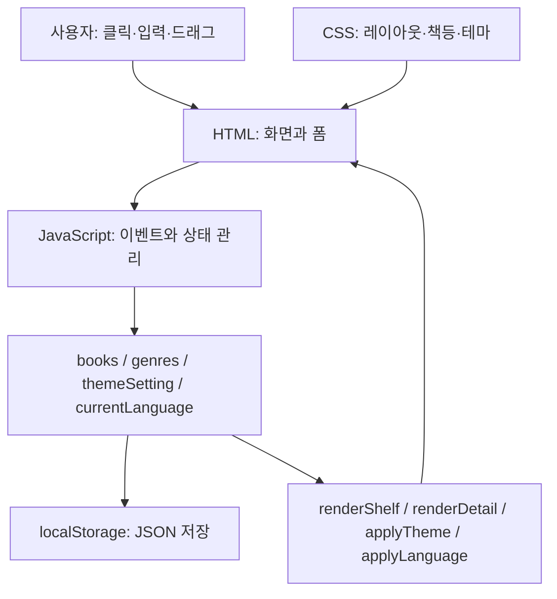
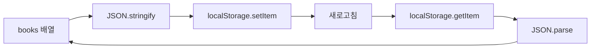
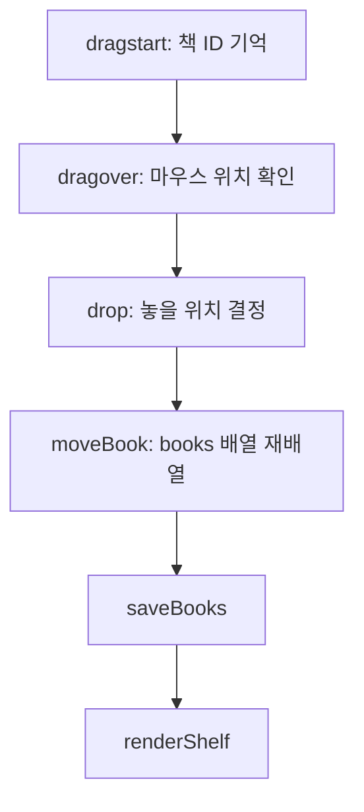
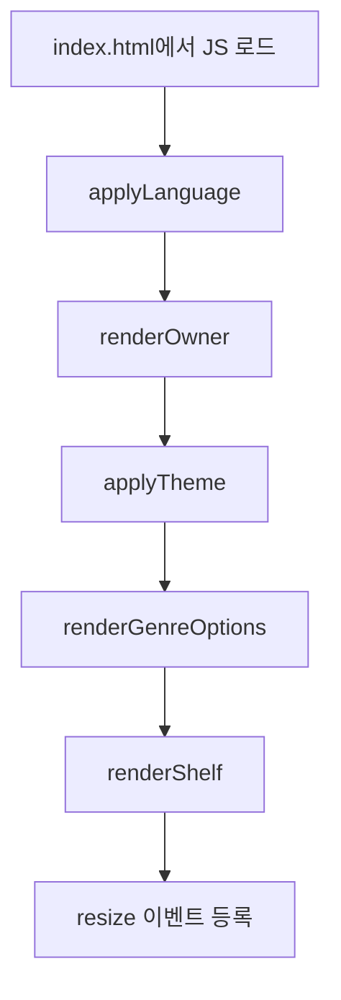
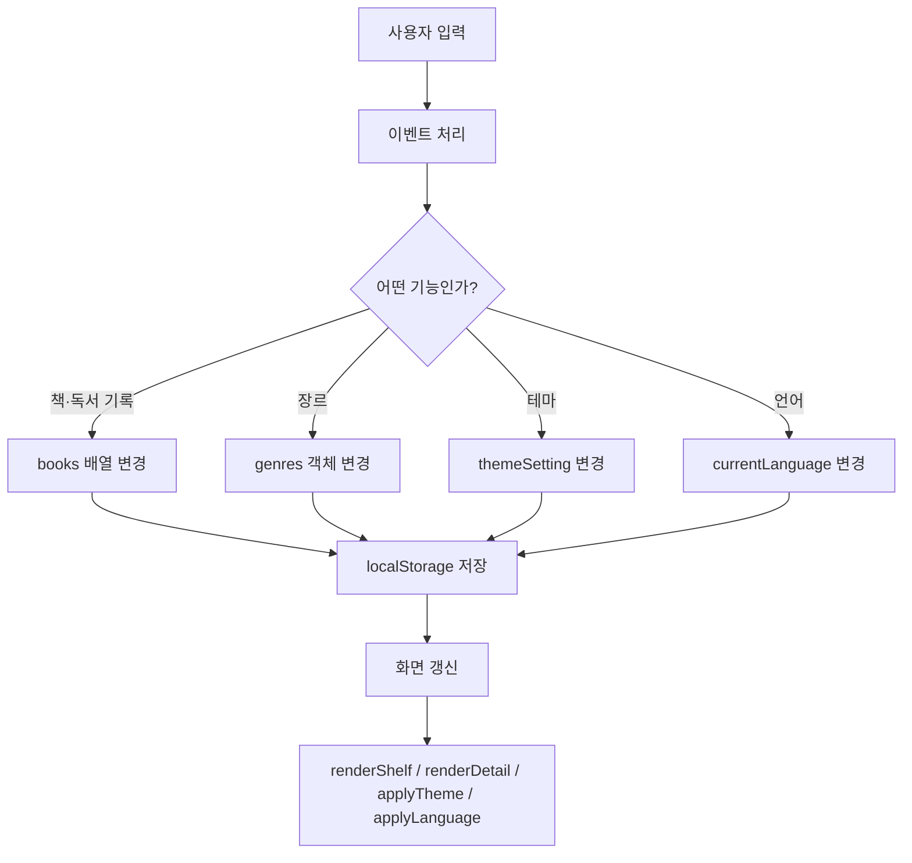

# Who's Bookcase v11 — 전체 프로그램 구조 및 핵심 코드 분석

> **Notion 정리용 개발 문서**  
> 기준: v11 Genre Fix. 아래 코드는 앞서 정리한 핵심 코드 발췌 및 설명용 예시를 포함하며, 전체 소스 파일을 그대로 옮긴 것은 아닙니다.

## 목차

1. [프로젝트 개요](#1-프로젝트-개요)
2. [프로젝트 폴더와 파일별 역할](#2-프로젝트-폴더와-파일별-역할)
3. [핵심 데이터 구조](#3-핵심-데이터-구조)
4. [localStorage 저장과 복원](#4-localstorage-저장과-복원)
5. [책장 렌더링](#5-책장-렌더링)
6. [드래그 정렬](#6-드래그-정렬)
7. [책 추가·수정·삭제](#7-책-추가수정삭제)
8. [장르 선택·추가·색상](#8-장르-선택추가색상)
9. [전체 테마](#9-전체-테마)
10. [언어 전환](#10-언어-전환)
11. [책 상세 화면](#11-책-상세-화면)
12. [독서 진행률](#12-독서-진행률)
13. [문장·메모](#13-문장메모)
14. [소유자 이름](#14-소유자-이름)
15. [최초 실행](#15-최초-실행)
16. [핵심 JavaScript 문법](#16-핵심-javascript-문법)
17. [기능 간 상호작용](#17-기능-간-상호작용)
18. [개선 사항](#18-개선-사항)
19. [학습 내용 및 결론](#19-학습-내용-및-결론)

---

## 1. 프로젝트 개요

| 항목 | 내용 |
|---|---|
| 프로젝트 | Who's Bookcase |
| 버전 | v11 — Genre Fix |
| 목적 | 개인 맞춤형 디지털 책장 및 독서 기록 관리 |
| 기술 | HTML5, CSS3, Vanilla JavaScript |
| 저장 | 브라우저 `localStorage` |
| 언어 | English / 한국어 |
| 서버·DB | 사용하지 않음 |
| 핵심 패턴 | 사용자 입력 → 이벤트 → 데이터 변경 → 저장 → 화면 갱신 |

책을 실제 책등처럼 배치하고, 제목·저자·출판사·장르·페이지 수를 관리한다. 책의 읽은 페이지, 인상 깊은 문장, 메모를 저장하며 책장 이름, 장르별 색상, 전체 테마와 언어를 개인화한다.



**핵심 설계:** HTML을 수동으로 고치지 않고 JavaScript 데이터 상태를 변경한 다음 렌더링 함수를 호출한다.

## 2. 프로젝트 폴더와 파일별 역할

```text
whos-bookcase-v11/
├── index.html
├── README.md
├── css/
│   └── style.css
└── js/
    ├── config.js
    ├── i18n.js
    ├── language.js
    ├── owner.js
    ├── genres.js
    ├── themes.js
    ├── shelf.js
    ├── detail.js
    ├── book-actions.js
    ├── notes.js
    └── app.js
```

| 파일 | 역할 |
|---|---|
| `index.html` | 책장·상세 화면·버튼·폼·팝업 |
| `css/style.css` | 책장 배치·테마·호버·책등 |
| `js/config.js` | 공통 상태·저장 키·유틸리티 |
| `js/i18n.js` | 번역 문자열과 `t()`·`applyLanguage()` |
| `js/language.js` | 언어 선택 이벤트 |
| `js/owner.js` | Who's 소유자 이름 |
| `js/genres.js` | 장르 선택·추가·색상 |
| `js/themes.js` | 테마 선택과 CSS 변수 |
| `js/shelf.js` | 책 생성·배치·드래그 |
| `js/detail.js` | 상세 정보·진행률 |
| `js/book-actions.js` | 책 추가·수정·삭제 |
| `js/notes.js` | 문장·메모 추가·수정·삭제 |
| `js/app.js` | 초기 실행 |

기능별 분리는 수정 위치를 명확히 한다. 다만 v11은 `import`/`export` 기반 ES 모듈이 아니라 **일반 스크립트가 전역 함수와 변수를 공유하는 구조**이므로 로딩 순서가 중요하다.

## 3. 핵심 데이터 구조

책 한 권은 객체, 전체 책은 `books` 배열로 관리한다.

```javascript
// 설명용 예시
const book = {
  id: 'book-001',
  title: 'The Little Prince',
  author: 'Antoine de Saint-Exupéry',
  publisher: 'Example Publisher',
  genre: 'Fiction',
  pages: 120,
  readPages: 60,
  comments: ['A book worth rereading.'],
  sentences: ['An unforgettable sentence.'],
  heightSeed: 25
};
```

| 속성 | 형식 | 설명 |
|---|---|---|
| `id` | String | 책 고유 식별자 |
| `title`, `author`, `publisher`, `genre` | String | 책의 서지 정보 |
| `pages`, `readPages` | Number | 총 페이지와 읽은 페이지 |
| `comments`, `sentences` | Array | 메모와 인상 깊은 문장 |
| `heightSeed` | Number | 책등 높이 결정용 보조값 |

```javascript
let books = readJSON(STORAGE_KEY, []);
// 새 책을 만들 때
const id = crypto.randomUUID();
```

제목은 바뀔 수 있으므로 고유 ID를 기준으로 수정·삭제·선택·정렬한다.

실행 중 상태 변수:

```javascript
let selectedId = null;       // 책장 선택 상태
let currentId = null;        // 현재 상세 화면의 책
let noteType = 'comments';   // 메모 또는 문장
let editingNoteIndex = null; // 수정 중인 항목 위치
let draggedBookId = null;    // 드래그 중인 책
```

이 변수들은 주로 **현재 화면 상태**이며 책 객체와 구분된다.

## 4. localStorage 저장과 복원

```javascript
const STORAGE_KEY = 'whos-bookcase-v1';

function readJSON(key, fallback) {
  try {
    const value = JSON.parse(localStorage.getItem(key));
    return value && typeof value === 'object' ? value : fallback;
  } catch {
    return fallback;
  }
}

let books = readJSON(STORAGE_KEY, []);

function saveBooks() {
  localStorage.setItem(STORAGE_KEY, JSON.stringify(books));
}
```

- `JSON.stringify()`는 객체·배열을 문자열로 변환한다.
- `localStorage.setItem()`은 문자열을 저장한다.
- `localStorage.getItem()`은 문자열을 읽는다.
- `JSON.parse()`는 저장 문자열을 다시 데이터로 복원한다.
- `try/catch`는 손상된 JSON으로 인한 예외를 처리한다.



**한계:** 현재 `readJSON()`은 객체 유형만 확인하고 배열의 필드 구조까지 검증하지 않는다. 저장 데이터의 스키마 검증을 추가하면 더 안전하다. 또한 브라우저의 출처와 저장 데이터에 종속되므로 기기 간 자동 동기화는 지원하지 않는다.

## 5. 책장 렌더링

`renderShelf()`는 책 목록을 DOM 버튼 요소로 변환해 위·아래 책장에 배치한다.

```javascript
// 핵심 흐름 발췌: 일부 이벤트·속성 생략
function renderShelf() {
  const top = $('shelf-top');
  const bottom = $('shelf-bottom');
  top.replaceChildren();
  bottom.replaceChildren();

  const topCapacity = top.clientWidth
    - parseFloat(getComputedStyle(top).paddingLeft)
    - parseFloat(getComputedStyle(top).paddingRight) - 6;

  let used = 0;
  let onBottom = false;

  books.forEach(book => {
    const el = document.createElement('button');
    el.type = 'button';
    el.className = 'book';
    el.textContent = book.title;

    const width = bookWidth(book.pages);
    el.style.width = `${width}px`;
    el.style.height = `${105 + (Number(book.heightSeed) || 0) % 55}px`;
    el.style.backgroundColor = colorForGenre(book.genre || '미분류');

    const needed = width + (used > 0 ? 5 : 0);
    if (!onBottom && used + needed > topCapacity) onBottom = true;
    (onBottom ? bottom : top).appendChild(el);
    if (!onBottom) used += needed;
  });
}
```

**순서:** 기존 요소 제거 → 사용 가능 너비 계산 → 책 배열 순회 → 버튼 생성 → 크기·색상 설정 → 위쪽부터 배치 → DOM에 추가.

| 메서드·속성 | 역할 |
|---|---|
| `replaceChildren()` | 이전 책 DOM 제거 |
| `clientWidth` | 내부 너비 확인 |
| `getComputedStyle()` | 계산된 CSS 패딩 읽기 |
| `forEach()` | 책 배열 순회 |
| `createElement()` | 버튼 생성 |
| `textContent` | 제목을 안전하게 텍스트로 표시 |
| `appendChild()` | 책장에 책 요소 삽입 |

### 페이지 수에 따른 책 두께

```javascript
function bookWidth(pages) {
  return Math.min(80, 24 + Math.floor((Number(pages) - 1) / 100) * 8);
}
```

| 페이지 | 너비 |
|---|---:|
| 1~100 | 24px |
| 101~200 | 32px |
| 201~300 | 40px |
| 301~400 | 48px |
| 401~500 | 56px |
| 501~600 | 64px |
| 601~700 | 72px |
| 701 이상 | 80px |

`Number()`로 숫자 변환, `Math.floor()`로 100페이지 구간 계산, `Math.min()`으로 최대 80px 제한을 수행한다.

### 책 선택

```javascript
el.addEventListener('click', () => {
  if (selectedId === book.id) openDetail(book.id);
  else {
    selectedId = book.id;
    renderShelf();
  }
});
```

첫 클릭은 선택, 같은 책의 두 번째 클릭은 상세 화면 진입이다.

## 6. 드래그 정렬



```javascript
function moveBook(sourceId, targetId, after = false) {
  const from = books.findIndex(b => String(b.id) === String(sourceId));
  if (from < 0) return;
  const [moved] = books.splice(from, 1);
  const to = books.findIndex(b => String(b.id) === String(targetId));
  if (to < 0) {
    books.splice(from, 0, moved);
    return;
  }
  books.splice(to + (after ? 1 : 0), 0, moved);
  saveBooks();
  renderShelf();
}
```

`findIndex()`로 위치를 찾고, `splice()`로 제거·삽입한다. `getBoundingClientRect()`와 마우스의 `clientX`를 비교해 대상 책의 앞/뒤를 결정한다. **픽셀 좌표가 아닌 배열 순서**를 저장하므로 화면 너비가 달라도 정렬이 유지된다.

예시: `[A, B, C, D]`에서 B를 D 뒤로 이동하면 `[A, C, D, B]`.

## 7. 책 추가·수정·삭제

### 추가

```javascript
// 새 책 객체 생성의 핵심 부분
books.push({
  id: crypto.randomUUID(),
  title: String(data.get('title')).trim(),
  author: String(data.get('author')).trim(),
  publisher: String(data.get('publisher')).trim(),
  genre,
  pages,
  readPages: 0,
  comments: [],
  sentences: [],
  heightSeed: Math.floor(Math.random() * 55)
});
saveBooks();
renderShelf();
```

`FormData`로 폼 값을 수집하고 검증한 후 `push()`로 책을 추가한다. `trim()`은 앞뒤 공백을 제거하고 `Math.random()`은 책등 높이의 다양성을 만든다.

### 수정

```javascript
Object.assign(book, {
  title, author, publisher, genre, pages,
  readPages: Math.min(readPages, pages)
});
saveBooks();
renderDetail();
```

`Object.assign()`은 지정한 필드만 변경하므로 ID와 기존 문장·메모를 유지한다. `Math.min()`으로 읽은 페이지가 총 페이지 수를 넘지 않게 한다.

### 삭제

```javascript
books = books.filter(book => book.id !== selectedId);
selectedId = null;
saveBooks();
renderShelf();
```

`filter()`는 선택한 ID를 제외한 새 배열을 반환한다. 삭제 전에 `confirm()`으로 확인한다.

## 8. 장르 선택·추가·색상

v11에서는 `datalist` 대신 실제 `<select>` 드롭다운을 사용한다.

```javascript
const defaultGenres = {
  'Uncategorized': '#c4b9aa',
  'Fiction': '#b4c7b1',
  'Essay': '#d8b3a6',
  'Humanities': '#a9c4d4',
  'Self-help': '#e9ce8c',
  'Science': '#c9b9d9'
};
```

### 장르 목록 만들기

```javascript
for (const name of Object.keys(genres)) {
  const option = document.createElement('option');
  option.value = name;
  option.textContent = displayGenre(name);
  select.appendChild(option);
}
```

`Object.keys()`는 장르명 목록을 반환한다. 실제 저장값은 `option.value`, 번역된 화면 표시는 `displayGenre()`가 담당한다.

### 새 장르

```javascript
const other = document.createElement('option');
other.value = '__custom__';
other.textContent = t('newGenreOption');
select.appendChild(other);

function selectedGenre(selectId, customId) {
  return $(selectId).value === '__custom__'
    ? $(customId).value.trim()
    : $(selectId).value;
}
```

`__custom__`을 선택하면 새 장르 입력창을 사용하고, 그렇지 않으면 기존 선택값을 반환한다.

### 장르 색상

```javascript
picker.addEventListener('input', () => {
  genres[name] = picker.value;
  saveGenres();
  renderShelf();
});
```

책은 색상 코드 대신 장르명을 저장한다. 따라서 장르 색상을 수정하면 그 장르에 속한 모든 책등이 새 색상으로 렌더링된다.

## 9. 전체 테마

테마는 총 10종: **White, Gray, Black, Ivory, Green, Peach, Blue, Sky Blue, Dark Green, Lavender**.

```javascript
// 테마 객체 예시
white: {
  name: 'White',
  page: '#ffffff',
  text: '#171717',
  muted: '#666666',
  frame: '#a8a8a8',
  wood: '#ededed',
  inside: '#fafafa',
  shadow: '#d2d2d2',
  panel: '#ffffff',
  border: '#d7d7d7',
  button: '#ffffff',
  hover: '#f0f0f0',
  accent: '#707070'
}
```

```javascript
function applyTheme() {
  const theme = themes[themeSetting.id] || themes.warm;
  const vars = {
    page: '--page', text: '--text', muted: '--muted',
    frame: '--shelf-frame', wood: '--shelf-wood',
    inside: '--shelf-inside', shadow: '--shadow',
    panel: '--panel', border: '--border',
    button: '--button', hover: '--button-hover', accent: '--accent'
  };
  for (const [key, cssVar] of Object.entries(vars)) {
    document.documentElement.style.setProperty(cssVar, theme[key]);
  }
}
```

`Object.entries()`는 키·값 쌍을 반환하고 `style.setProperty()`는 CSS 사용자 정의 변수 값을 변경한다. **전체 테마와 장르 색상은 서로 독립적인 설정**이다.

## 10. 언어 전환

`i18n.js`는 번역 사전과 번역 함수, `language.js`는 언어 선택 이벤트를 담당한다.

```javascript
function t(key, params = {}) {
  const template = TRANSLATIONS[currentLanguage][key]
    ?? TRANSLATIONS.en[key] ?? key;
  return template.replace(/\{(\w+)\}/g,
    (_, name) => String(params[name] ?? ''));
}
```

`??`는 값이 `null` 또는 `undefined`일 때 대체값을 사용한다. 번역이 없으면 영어, 영어도 없으면 키 자체를 사용한다. 정규식 `replace()`는 `{pages}` 같은 자리표시자를 치환한다.

```javascript
document.querySelectorAll('[data-language]').forEach(button => {
  button.addEventListener('click', () => {
    currentLanguage = button.dataset.language;
    localStorage.setItem(LANGUAGE_KEY, currentLanguage);
    applyLanguage();
    $('language-dialog').close();
  });
});
```

`dataset.language`는 `data-language` 속성을 읽는다. 번역은 **화면에 표시되는 문구**에 적용하며, 사용자가 입력한 책 제목과 메모는 자동 번역하지 않는다. 사용자 정의 장르 역시 기본 번역 사전에 없다면 원문으로 표시한다.

## 11. 책 상세 화면

```javascript
function openDetail(id) {
  currentId = id;
  $('shelf-view').hidden = true;
  $('detail-view').hidden = false;
  renderDetail();
}

function currentBook() {
  return books.find(b => b.id === currentId);
}
```

`hidden` 속성으로 책장·상세 화면을 전환하고, `find()`로 현재 책을 찾는다. 상세 화면의 책 정보는 클릭·호버 기반 편집 인터페이스를 사용한다.

## 12. 독서 진행률

읽은 페이지 수는 별도의 상시 입력창이 아니라 **진행률 그래프를 클릭한 뒤 입력**한다.

```javascript
function updateProgress() {
  const book = currentBook();
  if (!book) return;
  const percent = Math.round((book.readPages || 0) / book.pages * 100);
  $('progress-fill').style.width = `${percent}%`;
  $('progress-text').textContent =
    `${book.readPages || 0}p / ${book.pages}p · ${percent}% 읽음`;
  document.querySelector('.progress')
    .setAttribute('aria-valuenow', String(percent));
}
```

**계산식:** `읽은 페이지 / 전체 페이지 × 100`. `Math.round()`로 반올림하고 `style.width`로 그래프 길이를 조정한다. `aria-valuenow`는 접근성 속성이다.

```javascript
const input = $('read-pages');
const value = Number(input.value);
if (input.value.trim() === '' || !Number.isInteger(value)
    || value < 0 || value > book.pages) {
  alert(t('pagesRange', { pages: book.pages }));
  return;
}
book.readPages = value;
saveBooks();
updateProgress();
```

빈 값·정수 여부·0 이상·총 페이지 이하를 확인한다.

## 13. 문장·메모

`comments`와 `sentences` 배열을 공통 로직으로 처리한다.

```javascript
function openNote(type, index = null) {
  noteType = type;
  editingNoteIndex = index;
  const editing = index !== null;
  $('note-heading').textContent =
    (type === 'comments' ? t('notes') : t('sentences'))
    + ' — ' + (editing ? t('edit') : t('add'));
  $('note-content').value = editing
    ? (currentBook()?.[type]?.[index] || '') : '';
  $('delete-note').hidden = !editing;
  $('note-dialog').showModal();
}
```

`index === null`이면 새 항목 추가, 숫자면 기존 항목 편집이다. `?.`는 값이 없을 때 안전하게 접근하도록 하는 선택적 체이닝이다.

```javascript
if (editingNoteIndex === null) {
  book[noteType].push(value);
} else if (editingNoteIndex >= 0 && editingNoteIndex < book[noteType].length) {
  book[noteType][editingNoteIndex] = value;
}
saveBooks();
renderDetail();

// 삭제 시
book[noteType].splice(editingNoteIndex, 1);
saveBooks();
renderDetail();
```

문장·메모 목록에는 Edit/Delete 버튼을 상시 노출하지 않는다. 텍스트를 클릭해 편집창을 열고, 삭제는 편집창에서 처리한다.

## 14. 소유자 이름

```javascript
function renderOwner() {
  $('owner-name').textContent = localStorage.getItem(OWNER_KEY) || 'Who';
}
```

이름을 저장하고 화면에 표시한다. 저장값이 없으면 기본값 `Who`를 사용한다. 이름 편집은 호버·클릭 방식이다.

## 15. 최초 실행

```javascript
applyLanguage();
renderOwner();
applyTheme();
renderGenreOptions();
renderShelf();
window.addEventListener('resize', renderShelf);
```



`app.js`는 각 기능별 함수들을 호출하여 첫 화면을 완성한다. 브라우저 너비가 변경되면 책장을 다시 배치한다.

## 16. 핵심 JavaScript 문법

| 문법·메서드 | 역할 | 사용 예 |
|---|---|---|
| `const` / `let` | 변수 선언 | 요소 참조 / 상태 변수 |
| `function`, `=>` | 함수 정의 | 렌더링·이벤트 |
| `addEventListener()` | 이벤트 등록 | 클릭·입력·드래그 |
| `getElementById()` | ID로 요소 찾기 | HTML 접근 |
| `querySelectorAll()` | 여러 요소 선택 | 언어 버튼 |
| `createElement()` | DOM 생성 | 책·장르·메모 |
| `appendChild()` | DOM 삽입 | 책장 |
| `replaceChildren()` | DOM 교체·비우기 | 재렌더링 |
| `forEach()` | 배열 순회 | 책 목록 |
| `find()` | 조건에 맞는 요소 찾기 | 현재 책 |
| `findIndex()` | 요소 인덱스 찾기 | 드래그 |
| `push()` | 배열 끝에 추가 | 책·메모 |
| `splice()` | 배열 삽입·삭제 | 드래그·메모 삭제 |
| `filter()` | 조건에 맞는 새 배열 | 책 삭제 |
| `Object.assign()` | 기존 객체 필드 갱신 | 책 정보 수정 |
| `Object.keys()` | 객체 키 배열 | 장르 목록 |
| `Object.entries()` | 객체 키·값 쌍 | 테마 변수 |
| `FormData` | 폼 입력값 수집 | 책 추가·수정 |
| `Number()` | 숫자 변환 | 페이지 |
| `Number.isInteger()` | 정수 여부 | 진행률 검증 |
| `Math.floor()` | 내림 | 책 두께 |
| `Math.round()` | 반올림 | 진행률 |
| `Math.min()` | 최솟값 | 책 너비 상한 |
| `JSON.stringify()` | JSON 직렬화 | 저장 |
| `JSON.parse()` | JSON 역직렬화 | 복원 |
| `localStorage.setItem()` | 문자열 저장 | 데이터·설정 |
| `localStorage.getItem()` | 저장값 읽기 | 초기 실행 |
| `showModal()` / `close()` | 팝업 열기·닫기 | 책·메모 편집 |
| `preventDefault()` | 기본 동작 방지 | 폼·드래그 |

## 17. 기능 간 상호작용



**장르 수정 예:** Edit Book → 장르 선택 → `selectedGenre()` → 책 객체의 `genre` 변경 → `saveBooks()` → `renderDetail()` → 책장 렌더링 시 `colorForGenre()`로 새 책등 색상 적용.

**테마 수정 예:** Theme Settings → 테마 선택 → `themeSetting` 변경·저장 → `applyTheme()` → CSS 변수 변경.

## 18. 개선 사항

| 영역 | 현재 상태 또는 주의점 | 개선 방향 |
|---|---|---|
| 다국어 | 일부 동적 문자열에 한국어 하드코딩 | 모든 동적 텍스트를 `t()`에 연결 |
| 다국어 | 책 툴팁 등 일부 문구가 언어 설정과 분리 | 접근성·툴팁 번역 |
| 사용자 장르 | 직접 만든 장르는 자동 번역되지 않음 | 사용자 정의 장르 정책 마련 |
| 저장 데이터 | `readJSON()`이 스키마 전체를 검사하지 않음 | 배열·필수 필드 유효성 검사 |
| 코드 구조 | 전역 변수·함수 공유 | ES 모듈로 분리 |
| 드래그 | PC 마우스 중심 | 모바일 Pointer Events 지원 |
| 저장 | 브라우저 로컬 저장만 사용 | JSON 내보내기·가져오기 |
| 접근성 | 동적 ARIA·안내 문구 일부 미번역 | 언어별 접근성 문구 정리 |

> **정확성 주의:** v11은 영어·한국어 전환을 제공하지만 일부 동적 문자열까지 완벽하게 번역되는 상태라고 단정할 수 없다. 위 내용은 코드 구조 분석이며, 모든 기능의 브라우저 상호작용 테스트를 완료했다는 의미는 아니다.

## 19. 학습 내용 및 결론

1. **DOM 조작:** JavaScript로 HTML 요소를 동적으로 생성·제거한다.
2. **이벤트 기반 프로그래밍:** 클릭·입력·드래그가 기능 실행의 출발점이다.
3. **배열·객체 상태 관리:** 책은 객체, 전체 목록은 배열로 관리한다.
4. **데이터 직렬화:** JSON으로 변환해 localStorage에 저장한다.
5. **관심사 분리:** 책 관리·장르·테마·언어·기록을 파일별로 나눈다.

**결론:** Who's Bookcase의 핵심은 사용자 행동에 따라 데이터 상태를 변경하고, 그 상태를 기준으로 화면을 다시 렌더링하는 구조다. 이 원리를 통해 책 추가·수정·삭제, 드래그 정렬, 장르 색상, 전체 테마, 언어 전환, 독서 진행률, 문장·메모 관리 기능이 연결된다.

---

## 이어서 공부할 질문

1. 각 JavaScript 파일의 **실제 전체 코드를 한 줄씩 해설**한다면?
2. v11 코드의 **오류 가능성과 수정 우선순위**는?
3. 발표에서 교수님이 물을 수 있는 **심화 기술 질문과 답변**은?
